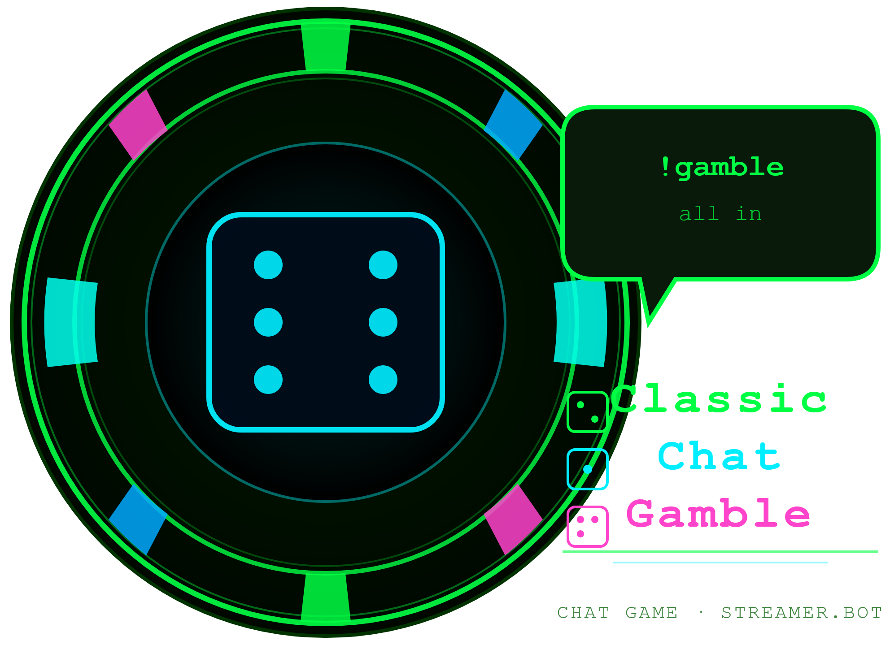

  

<h1 align="center">Classic Chat Gamble</h1>

  <b>The most classic chat game — on Twitch, YouTube and Kick.</b> 
  Every bet rolls against odds you set, with a jackpot on top.

  
  
  
  
  

  <a href="https://github.com/aaskjer/Classic-Chat-Gamble/releases"><b>Download</b></a> &nbsp;·&nbsp;
  <a href="Setup-Guide.md"><b>Setup Guide</b></a> &nbsp;·&nbsp;
  <a href="FAQ.md"><b>FAQ</b></a> &nbsp;·&nbsp;
  <a href="Import-String.md"><b>Import String</b></a>

---

## 📖 Overview

Classic Chat Gamble is a chat game for Streamer.bot. Viewers bet with `!gamble` or a Channel Points
reward, and each bet rolls against the odds you set: jackpot, win or loss. Wins and jackpots pay on top of
the bet.

## ✨ Highlights

- 🎲 **Bets in any form.** Numbers, `all`, `half`, `quarter`, `third`, `random`, percentages like `50%` or
  shorthand like `10k`, `2.5m` and `1b`.
- 🎰 **Jackpots.** They have their own chance and multiplier on top of a normal win. One Fairness slider sets
  all the odds, or you tune each one by hand.
- 🎫 **Channel Points on Twitch.** A reward can replace the chat command, with four bet modes: reward cost,
  typed amount, fixed or free. A redemption that does not end in a gamble is refunded. YouTube and Kick
  keep the chat command.
- 🆓 **Free play.** Permanent, or switched on and off by moderator command. Nobody pays, nobody wins points.
- 🚫 **Cooldowns, blocks and an addicted list.** Global and per-viewer cooldowns with their own messages,
  blocked viewers and Streamer.bot groups, and cut winnings for viewers on the addicted list.
- ⚙️ **One settings window.** Built on [UIFramework for streamer.bot](https://github.com/aaskjer/UIFramework-Streamer.bot)
  and downloaded on first open: light and dark themes, `Try a bet`, which plays a round with your odds and shows
  the exact chat message, and a customise mode that lets you rename, reorder and hide pages and fields. Every
  message can be edited or translated, and a daily log records every gamble and refund.

---

## ⚙️ Settings window

The settings action opens a window from [UIFramework for streamer.bot](https://github.com/aaskjer/UIFramework-Streamer.bot),
a separate DLL that is fetched automatically.

- **First open:** a dialog asks whether to download `UIFramework.dll` from the framework's GitHub release into
  `<Streamer.bot>\UIFramework\lib\`. The file is checked against its published SHA-256 before it is used. *No*
  opens that folder so you can put the DLL there yourself; *Cancel* leaves everything as it is.
- **Updates:** when a newer framework release is out, the window asks before it downloads anything. *Cancel* skips
  that version for good.
- **Turning the update check off:** put `"autoUpdate": false` into `uiframework.layout.json`, next to the settings
  file `<Streamer.bot>\Chat Games\Classic Chat Gamble\configs.json` (create it as `{ "autoUpdate": false }` if it is not there yet). The window then
  opens with the DLL it has and asks nothing.
- **Without the window:** the game itself never loads the DLL. Disable the settings action and the game plays on
  with its settings file, which you can still edit by hand.

---

## Credits

- **Author:** [aaskjer on Twitch](https://twitch.tv/aaskjer) · [aaskjer.github.io](https://aaskjer.github.io/)
- **Built for:** [Streamer.bot](https://streamer.bot) by [nate1280](https://www.patreon.com/c/nate1280/home)
- **Works with:** [Currency Core by StreamUP](https://streamup.tips/product/currency-core) · [LOYALTY POINTS by tawmae](https://tawmae.xyz/loyalty-points)
- **Community:** [Classic Chat Gamble on the Streamer.bot Discord](https://discord.com/channels/834650675224248362/1446874050310836396/1446874050310836396)
- **Thanks:** YOU ♡
