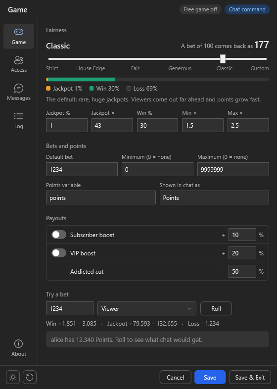
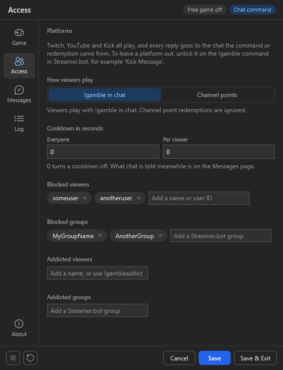
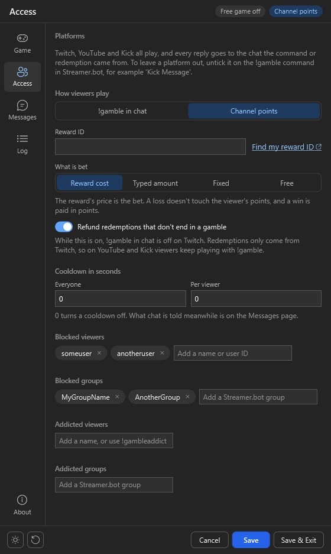
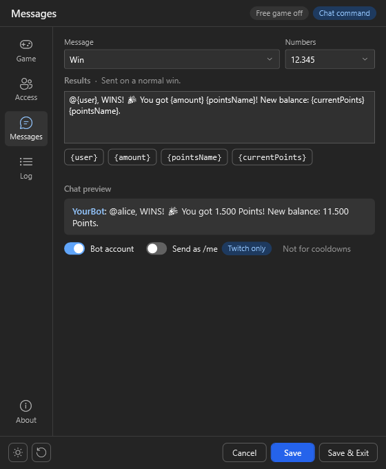
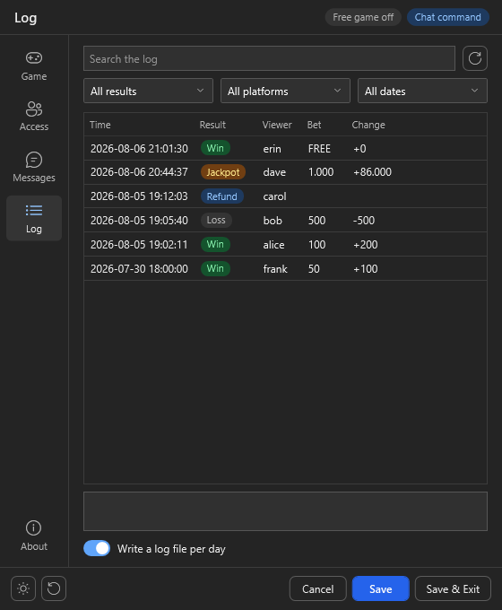
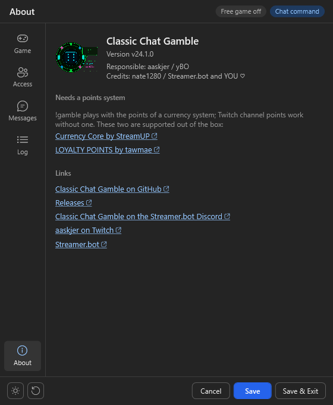

# Import

In [streamer.bot](https://streamer.bot/), click `Import` and drag the [ClassicChatGamble.sb](https://github.com/aaskjer/Classic-Chat-Gamble/releases) file into the window, or paste the [import string](https://github.com/aaskjer/Classic-Chat-Gamble/blob/main/Import-String.md).

Click `Import`, then `Yes` in both popups that follow.

## Enable the commands

The four commands arrive switched off. Enable them in the `Commands` tab of Streamer.bot, in the group `[CCG] - Classic Chat Gamble`:

| Command | Who | What it does |
|---------|-----|--------------|
| `!gamble` (or `!gambel`) | Everyone | Plays a round, with the amount the viewer names or the Default bet |
| `!SetFreeGamble` | Moderators | Turns Free Game Mode on |
| `!EndFreeGamble` | Moderators | Turns Free Game Mode off |
| `!gambleaddict` | Moderators | Puts a viewer on the addicted list (`add`) or takes them off (`remove`) |

The moderator commands come with `Moderators` as their only allowed group, and you as the broadcaster can always use them. To change who may, edit the command's permissions in Streamer.bot.

Twitch, YouTube and Kick all play. To leave a platform out, open the command and untick its source, for example `Kick Message`.

# Setup

In the `Actions` tab, select `[CCG] - Settings`, right-click the `Test` trigger and click `Test Trigger`. The settings window opens.

Hover over an option for a tooltip with the details. `Save` or `Ctrl+S` keeps your changes, `Save & Exit` also closes the window, and `Ctrl+1` to `Ctrl+5` switch between the pages. Changes you haven't saved yet show up in orange at the bottom. The two buttons at the bottom left switch between dark and light and reset everything to the defaults. The strip at the top tells you whether Free Game Mode is on and how viewers play, and a red `Update` pill appears there when a new version is out.

## Game

- **Fairness**: one slider sets the odds, from `Strict`, where the house wins, to `Classic`, the defaults with rare, huge jackpots. The bar shows the chance of a jackpot, a win and a loss, and the number above it what a bet of 100 brings back on average. Type your own numbers below the slider and it moves to `Custom`.
- **Bets and points**: Default, Minimum and Maximum bet, the points variable and the name chat uses for your points. Currency Core by StreamUP and LOYALTY POINTS by tawmae are detected on their own.
- **Payouts**: the Subscriber and VIP boosts, both Twitch only, and the cut for addicted viewers.
- **Try a bet**: pick a bet and who plays, then click `Roll` to see exactly what chat would get. Nothing is saved, and nobody's points change.

## Access

- **How viewers play**: with `!gamble` in chat, or on Twitch with a channel point reward.
- **Cooldown in seconds**: one for everyone, one per viewer. Saving writes them straight into the `!gamble` command.
- **Blocked and addicted viewers and groups**: type a name and press `Enter`; `×` removes it again. Blocked viewers can't play. Addicted viewers win less and get messages of their own, and `!gambleaddict` adds them from chat too.

### Twitch Channel Points

1. Pick `Channel points`. `!gamble` is then off on Twitch, while YouTube and Kick keep using it.
2. Paste the ID of your reward into `Reward ID`; `Find my reward ID` helps you look it up. Without one, no redemption starts a gamble.
3. Pick what is bet:
   - `Reward cost`: the reward's price is the bet. A loss doesn't touch the viewer's points, and a win is paid in points.
   - `Typed amount`: viewers type a bet into the reward. It's paid from their own points, just like `!gamble`.
   - `Fixed`: every redemption bets the amount you set.
   - `Free`: nothing is won or lost.

A redemption that doesn't end in a gamble is refunded, as long as the reward doesn't skip the reward requests queue.

## Messages

Edit any message the game sends, or translate it into your language. Pick one from the list and click a placeholder to insert it; the chat preview shows the result the way chat will read it. `Numbers` sets how chat writes numbers, like 12.345 or 12,345.

Below the preview you choose the sender, your bot account or your own, and `Send as /me`, which only exists on Twitch. Game messages and cooldown messages are set separately.

## Log

Every gamble and refund, day by day. Search for names or amounts, filter by result, platform or date, and click a line to read all of it. `Write a log file per day` turns logging on or off.

## About

The version, links, and the points systems supported out of the box.

# How a gamble is decided

| Outcome | When | Payout |
|---------|------|--------|
| 🎰 **Jackpot** | Roll ≤ Jackpot % | `bet × random(Min×–Max×) × Jackpot×` |
| 🎉 **Win** | Roll ≤ Win %, on top of the jackpot chance | `bet × random(Min×–Max×)` |
| ❌ **Loss** | Everything else | `-bet` |

Wins and jackpots are paid on top of the bet. The Subscriber and VIP boosts raise them, and the Addicted cut lowers them.

# Other features

## Arguments
After every gamble the game keeps its result, which comes in handy for further actions. Run `GetLastGambleResult` with an `Execute C# Method` sub-action to get these arguments:

| Argument | Value |
|----------|-------|
| `gambleOutcome` | `WIN`, `LOSS`, or `JACKPOT` |
| `gambleAmount` | Points won or lost |
| `gambleBetAmount` | The original bet |
| `gamblePreviousPoints` | Balance before the gamble |
| `gambleNewPoints` | Balance after the gamble |
| `gambleCurrency` | Currency name |
| `gambleOutcomeMessage` | Pre-formatted result summary |

The custom triggers `CCG: Gamble Win`, `CCG: Gamble Loss`, `CCG: Gamble Jackpot`, `CCG: Free Game Start` and `CCG: Free Game End` start your own actions at the right moment. A gamble's triggers fire once its result is stored, so `GetLastGambleResult` already returns that gamble.

## Free Game Mode
`!SetFreeGamble` turns it on and `!EndFreeGamble` turns it off again. While it's on, nobody pays or wins points, channel point redemptions included, and each viewer gets a one-time notice with their first gamble. The start and end messages go to the chat the command was used in.

A Default bet of 0 doesn't make the game free: it means viewers always have to name an amount.

---

[Frequently Asked Questions](https://github.com/aaskjer/Classic-Chat-Gamble/blob/main/FAQ.md) · [Report an issue](https://github.com/aaskjer/Classic-Chat-Gamble/issues)
